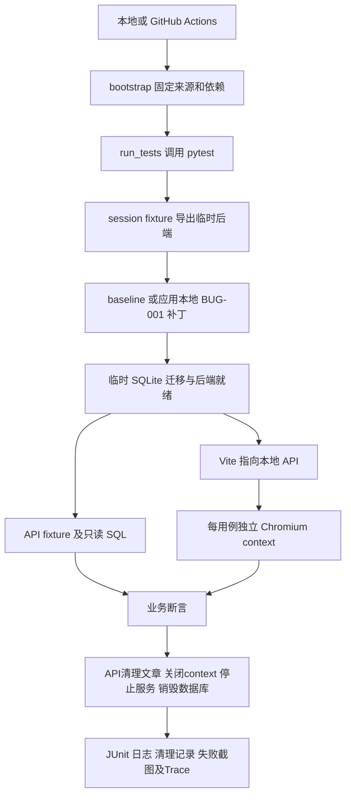

# 测试工程架构

## 目录职责

| 目录/文件 | 职责 |
| --- | --- |
| upstream/ | 固定 SHA 的开源业务系统，下载后验证，不提交 |
| config/ | 上游 manifest、Python 完整版本锁、npm lock |
| patches/BUG-001.patch | 专门处理 JWT APIError 的本地补丁 |
| scripts/bootstrap.py | 版本检查、源码下载、虚拟环境/依赖安装、前端构建、浏览器安装 |
| scripts/run_tests.py | 同一套本地/CI执行入口、超时、日志、JUnit统计、临时目录处置 |
| tests/conftest.py | 环境、API、用户、文章和数据库 fixture |
| tests/support/server.py | 导出源码、应用补丁、迁移临时数据库、后端就绪/销毁 |
| tests/support/frontend.py | VITE_API_URL 注入、随机端口、就绪与停止 |
| tests/support/client.py | requests 会话及 Token 请求封装 |
| tests/support/database.py | 标准库 sqlite3 只读连接及参数化查询 |
| tests/api/ | 注册、登录、鉴权、文章、认证边界 |
| tests/ui/conftest.py | 官方插件扩展、context隔离、网络边界、数据/浏览器清理 |
| tests/ui/pages/ | 登录/首页与文章页面 POM |
| tests/ui/test_business.py | 8个真实UI业务场景 |
| .github/workflows/tests.yml | Linux工作流编排，复用上述入口 |
| .runtime/ | 不提交的浏览器、运行证据、临时文件 |
| docs/ | 方案、真实阶段报告、面试材料和公开统计 |

## 一轮执行的数据流

数据库路径由 BackendEnvironment 显式传递，不从用户任意 DATABASE_URL 猜测。数据准备和业务动作分离：API注册 UI 用户，UI 登录和编辑仍由浏览器真实操作。SQL只用于观察持久化结果，不代替业务写操作。

每轮源码副本和数据库独立；每个用户/文章唯一命名；每个 UI context 隔离 cookie/localStorage。fixture 使用 yield/finally 在正常断言失败后清理，启动器使用 tempfile.mkdtemp 在 /tmp 创建权限受限的 rw-* 短路径，只移除它本次创建的临时根目录；避免Linux Chromium的Unix socket因工作目录路径过长而启动失败。硬断电/SIGKILL 无法保证 Python finalizer 执行，CI runner 回收是最后边界，不能宣称任意故障均能优雅清理。

前端构建是安装验证；UI测试实际使用 Vite 开发服务，并非生产静态包部署验证。数据库仅覆盖 SQLite，未验证生产 PostgreSQL。
